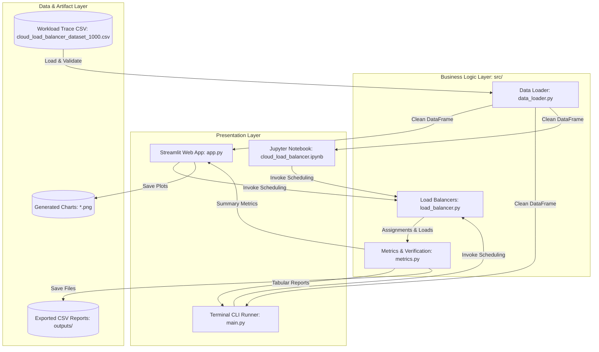
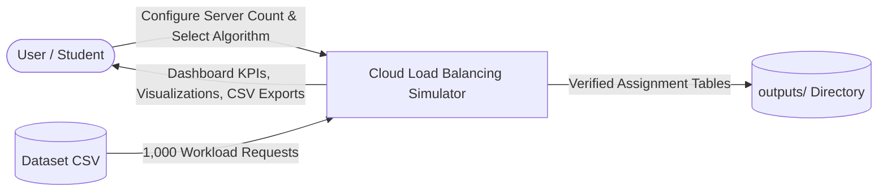
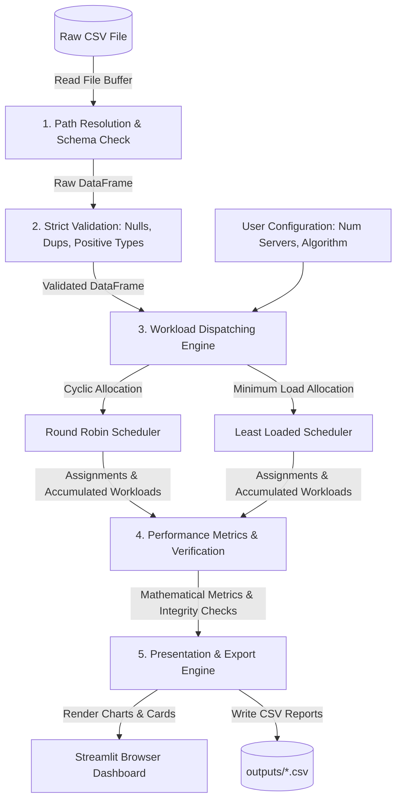

# Cloud Server Load Balancing Simulator
## Academic Project Report & Technical Documentation

---

### Project Cover Page

```
========================================================================================
                          DEPARTMENT OF COMPUTER SYSTEMS ENGINEERING
                               [UNIVERSITY / INSTITUTE NAME]

                         CLOUD AND DISTRIBUTED COMPUTING (SEMESTER PROJECT)
========================================================================================

PROJECT TITLE:
    CLOUD SERVER LOAD BALANCING SIMULATOR: AN EMPIRICAL EVALUATION OF
    CYCLIC AND WORKLOAD-AWARE REQUEST DISPATCHING IN DISTRIBUTED ENVIRONMENTS

STUDENT NAME:           [Student Name]
ROLL NUMBER / ID:       [Roll Number / ID]
DEGREE PROGRAM:         Bachelor of Engineering in Computer Systems Engineering
SEMESTER / SESSION:     [Semester, e.g., 7th Semester, Fall 2026]

COURSE TITLE:           Cloud and Distributed Computing
COURSE INSTRUCTOR:      [Instructor Name / Professor Name]
SUBMISSION DATE:        October 20, 2026

========================================================================================
```

---

## Table of Contents
1. [Abstract](#1-abstract)
2. [Introduction](#2-introduction)
3. [Problem Statement](#3-problem-statement)
4. [Project Objectives](#4-project-objectives)
5. [Scope and Scientific Limitations](#5-scope-and-scientific-limitations)
6. [Connection to Cloud & Distributed Computing](#6-connection-to-cloud--distributed-computing)
7. [System Requirements](#7-system-requirements)
8. [Tools, Libraries, and Technologies](#8-tools-libraries-and-technologies)
9. [System Architecture Diagram](#9-system-architecture-diagram)
10. [Data Flow Diagram (DFD)](#10-data-flow-diagram-dfd)
11. [Algorithm Flowcharts](#11-algorithm-flowcharts)
12. [Workload Dataset Specification & Validation](#12-workload-dataset-specification--validation)
13. [Algorithmic Foundations & Pseudocode](#13-algorithmic-foundations--pseudocode)
14. [Software Implementation & Interactive Dashboard](#14-software-implementation--interactive-dashboard)
15. [Testing Methodology & Verified QA Results](#15-testing-methodology--verified-qa-results)
16. [Performance Evaluation & Empirical Results](#16-performance-evaluation--empirical-results)
17. [Discussion of Findings](#17-discussion-of-findings)
18. [Project Limitations & Future Directions](#18-project-limitations--future-directions)
19. [Conclusion](#19-conclusion)
20. [References](#20-references)
21. [Appendix: Environment Setup & Directory Structure](#21-appendix-environment-setup--directory-structure)

---

## 1. Abstract

Load balancing is a foundational design pattern in cloud and distributed systems, responsible for distributing client requests across compute clusters to maximize resource utilization and prevent instance starvation. This project presents a software simulation framework developed in Python to evaluate the operational trade-offs between static cyclic dispatching (**Round Robin**) and dynamic greedy workload-aware dispatching (**Least Loaded**). 

The simulation processes an empirical cloud trace of **1,000 requests** totaling **195,367 milliseconds** of computational workload across a configurable cluster of logical compute nodes. While Round Robin achieves perfect task-count parity (334, 333, and 333 tasks across 3 nodes), it incurs a severe **4,252 ms workload imbalance** due to request execution variance (ranging from 30 ms to 799 ms). In contrast, the Least Loaded heuristic continuously tracks accumulated server workloads, compressing the inter-server imbalance to **415 ms**—representing a **90.24% reduction in load imbalance**. 

The system provides strict data validation, an automated test suite verifying 25 boundary conditions, reproducible CSV report generation, and an interactive **Streamlit** dashboard. This study serves as a pedagogical platform demonstrating the necessity of workload-aware dispatching in heterogeneous cloud workloads.

---

## 2. Introduction

Modern web applications, microservices, and big-data processing pipelines run on clustered server instances deployed across private and public cloud datacenters (such as Amazon Web Services, Google Cloud Platform, and Microsoft Azure). When clients issue concurrent requests, a single server node cannot sustain peak throughput without encountering CPU exhaustion, high memory contention, and connection queuing.

To solve this scaling bottleneck, distributed systems place a **Load Balancer** at the ingress boundary. The load balancer receives all incoming requests and routes each request to an available server within a cluster according to a scheduling policy. 

Load balancing algorithms fall broadly into two classifications:
1. **Static / Workload-Unaware Schedulers:** Algorithms such as Round Robin and Random Dispatching assign requests without inspecting the request's computational complexity or the server's current backlog.
2. **Dynamic / Workload-Aware Schedulers:** Algorithms such as Least Loaded, Least Connections, and Shortest Expected Delay monitor real-time server workloads or connection queues to balance actual computational strain.

This semester project implements, verifies, and analyzes these core concepts through a clean software engineering approach, delivering both an interactive graphical interface and a strictly tested backend package.

---

## 3. Problem Statement

In distributed cloud environments, incoming requests exhibit extreme variance in computational demand. For example, a simple API read operation may require only 30 milliseconds of CPU burst time, whereas generating an analytical report or transforming video media can require over 700 milliseconds.

When a workload-unaware policy like Round Robin is employed:
* Requests are distributed uniformly by count.
* However, short and long tasks arrive unpredictably. If several computationally expensive tasks are consecutively routed to the same node, that server experiences high CPU utilization and prolonged makespan, while sibling nodes sit idle.
* This discrepancy is termed **Load Imbalance**.

Therefore, the engineering challenge is to simulate, measure, and demonstrate how dynamic workload-aware scheduling mitigates this imbalance by steering compute-heavy requests toward servers with smaller backlogs.

---

## 4. Project Objectives

The project accomplishes the following objectives:
1. **Data Ingestion & Strict Validation:** Implement a robust data ingestion layer that checks column schemas, detects missing values, catches duplicate request identifiers, and validates positive numerical processing times without silent data corruption.
2. **Algorithm Implementation:** Implement deterministic versions of both **Round Robin** and **Least Loaded** scheduling algorithms supporting arbitrary cluster sizes ($N \ge 1$).
3. **Formal Metric Evaluation:** Measure total cluster workload, maximum server load, minimum server load, workload imbalance ($\Delta W = W_{\max} - W_{\min}$), estimated makespan ($W_{\max}$), and load imbalance reduction percentage.
4. **Correctness Verification:** Mathematically prove that every incoming request is assigned exactly once, zero requests are dropped or duplicated, and total assigned workload strictly equals the dataset's total input workload.
5. **Interactive Visualization:** Build an academic Streamlit monitoring dashboard enabling real-time server scaling (2 to 8 nodes), assignment browsing, and dynamic chart generation.
6. **Reproducible Quality Assurance:** Maintain a comprehensive automated unit test suite using `pytest` and `unittest` covering boundary conditions and edge cases.

---

## 5. Scope and Scientific Limitations

### 5.1 Project Scope
* Simulation of request assignment across a cluster of logical server nodes.
* Processing of a validated workload dataset consisting of 1,000 distinct cloud requests.
* Comparative benchmark reporting through interactive browser charts, terminal CLI tables, and exported CSV summaries.

### 5.2 Scientific & Educational Limitations
> [!IMPORTANT]
> **Important Simulation Disclaimer:**
> 1. **No Physical Cloud Deployment:** This project is a local software simulation; it does not deploy virtual machines, Docker containers, or cloud instances.
> 2. **Cumulative Processing Model:** The primary simulation evaluates static cumulative task allocation. Estimated makespan ($W_{\max}$) assumes that servers execute their assigned batch in parallel without task preemption.
> 3. **Zero Overhead Assumption:** The model assumes zero inter-node communication latency, zero TCP handshake latency, zero scheduling overhead, and zero OS context-switching penalties.
> 4. **No Real-World Performance Claims:** The reported 90.24% imbalance reduction reflects algorithmic workload balancing across synthetic numerical durations; it must not be interpreted as a measured speedup on physical hardware.

---

## 6. Connection to Cloud & Distributed Computing

This simulator directly reflects core concepts taught in undergraduate Distributed Systems curricula:

```
+---------------------------------------------------------------------------------------+
| Core Curriculum Concept               | Simulator Implementation                      |
+=======================================+===============================================+
| Client-Server Architecture            | Synthetic request stream dispatched to nodes  |
+---------------------------------------+-----------------------------------------------+
| Horizontal Scaling                    | Dynamic cluster sizing (2 to 8 virtual nodes) |
+---------------------------------------+-----------------------------------------------+
| Load Imbalance & Makespan Minimization| Quantified by max-min spread and makespan     |
+---------------------------------------+-----------------------------------------------+
| Ingress Load Balancing (Layer 7 / L4) | Emulated by the dispatching scheduler loop    |
+---------------------------------------+-----------------------------------------------+
| Determinism in Distributed Systems    | Deterministic tie-breaking across idle nodes  |
+---------------------------------------+-----------------------------------------------+
```

* **Layer 7 Ingress Load Balancing:** In cloud platforms like AWS Application Load Balancers (ALB) or Kubernetes Ingress Controllers, reverse proxies inspect request metadata (payload size, endpoint path) to route traffic intelligently.
* **Amdahl's Law and Bottleneck Formation:** If one server in a distributed pool is assigned excessive processing time, the overall batch makespan is constrained by that slowest node, illustrating why minimizing $W_{\max}$ directly improves cluster throughput.

---

## 7. System Requirements

### 7.1 Functional Requirements (FR)
* **FR-1 (Data Ingestion):** The system shall load CSV workload files using relative project-root paths and validate all 5 schema headers (`Request_ID`, `Arrival_Time`, `Request_Type`, `Processing_Time_ms`, `Data_Size_MB`).
* **FR-2 (Data Validation):** The system shall reject missing values, non-numeric processing times, negative processing times, and duplicate request IDs with descriptive errors.
* **FR-3 (Configurable Cluster):** The system shall support cluster configuration from 1 to $N$ servers, defaulting to `Server 1`, `Server 2`, and `Server 3`.
* **FR-4 (Round Robin Scheduling):** The system shall assign requests in cyclic sequential order ($i \pmod N$) and maintain per-server cumulative workload totals.
* **FR-5 (Least Loaded Scheduling):** The system shall assign each request to the server with the lowest current workload accumulation, resolving ties deterministically by server declaration index.
* **FR-6 (Metrics Calculation):** The system shall compute total workload, max load, min load, load imbalance, makespan, and percentage reduction (protected against division-by-zero).
* **FR-7 (Export Capabilities):** The system shall export assignment mappings and performance comparisons to CSV files in an `outputs/` folder without overwriting the source dataset.
* **FR-8 (Interactive Dashboard):** The system shall provide a Streamlit web interface with real-time controls, server progress meters, Matplotlib charts, and searchable assignment tables.

### 7.2 Non-Functional Requirements (NFR)
* **NFR-1 (Modularity):** Business logic shall reside strictly within the `src/` package, separating algorithmic execution from UI presentation.
* **NFR-2 (Determinism):** Schedulers must yield identical outputs for identical inputs across multiple runs.
* **NFR-3 (Performance):** Simulation of 1,000 requests across any algorithm shall execute in less than 500 milliseconds.
* **NFR-4 (Data Safety):** The system must guarantee that input dataset files are never modified, overwritten, or deleted during simulation or export operations.
* **NFR-5 (Defensive Compatibility):** The dashboard must render cleanly across differing versions of Streamlit and Pandas without deprecation crashes.

---

## 8. Tools, Libraries, and Technologies

| Technology | Role in Project | Justification |
| :--- | :--- | :--- |
| **Python 3.10+** | Core Programming Language | High-level, readable, rich scientific ecosystem, and cross-platform compatibility. |
| **Pandas** | Data Ingestion & Manipulation | Efficient tabular data structures (`DataFrame`), vectorized operations, and CSV I/O. |
| **Matplotlib** | Static Data Visualization | Publication-quality chart generation for distributions, grouped bars, and balance plots. |
| **Streamlit** | Web Application Dashboard | Rapid, clean web GUI development in pure Python with native reactive UI controls. |
| **Pytest / Unittest** | Automated Testing Framework | Test execution, assertion verification, edge-case coverage, and continuous validation. |
| **Git / GitHub** | Version Control | Source code tracking, branch management, and repository preservation. |

---

## 9. System Architecture Diagram

The software architecture follows a clean layered design separating data ingestion, business logic, presentation, and persistent storage:



---

## 10. Data Flow Diagram (DFD)

### 10.1 Level-0 Context Diagram


### 10.2 Level-1 Detailed Data Flow Diagram


---

## 11. Algorithm Flowcharts

### 11.1 Round Robin Algorithm Flowchart
```mermaid
flowchart TD
    Start([Start Round Robin]) --> Init[Initialize server_loads = 0 for each server in Servers<br>Initialize i = 0, assignments = empty list]
    Init --> Check{More requests in dataset?}
    Check -- Yes --> Select[Select server = Servers[i % num_servers]]
    Select --> Extract[Read request processing_time]
    Extract --> Accumulate[server_loads[server] += processing_time]
    Accumulate --> Record[Append assignment record to assignments list]
    Record --> Inc[i = i + 1]
    Inc --> Check
    Check -- No --> Output[Return assignments DataFrame and server_loads dictionary]
    Output --> Done([End])
```

### 11.2 Least Loaded Algorithm Flowchart
```mermaid
flowchart TD
    Start([Start Least Loaded]) --> Init[Initialize server_loads = 0 for each server in Servers<br>Initialize assignments = empty list]
    Init --> Check{More requests in dataset?}
    Check -- Yes --> FindMin[Find server with minimum current server_loads[s]<br>Tie-breaking: First server in declared list order]
    FindMin --> Extract[Read request processing_time]
    Extract --> Accumulate[server_loads[selected_server] += processing_time]
    Accumulate --> Record[Append assignment record to assignments list]
    Record --> Check
    Check -- No --> Output[Return assignments DataFrame and server_loads dictionary]
    Output --> Done([End])
```

---

## 12. Workload Dataset Specification & Validation

### 12.1 Dataset Overview
The simulator uses a realistic synthetic workload trace named [`cloud_load_balancer_dataset_1000.csv`](file:///c:/Users/husna/Downloads/Cloud_Load_Balancer/cloud_load_balancer_dataset_1000.csv) containing **1,000 request records**.

### 12.2 Data Dictionary
| Column Name | Data Type | Description | Observed Domain / Range |
| :--- | :--- | :--- | :--- |
| `Request_ID` | String | Unique alpha-numeric task identifier | `REQ0001` through `REQ1000` |
| `Arrival_Time` | String (Timestamp) | Request arrival timestamp ($YYYY$-$MM$-$DD$ $hh$:$mm$:$ss$) | `2026-10-19 09:00:02` to `09:59:56` |
| `Request_Type` | String (Categorical) | Classification of computing task | 4 distinct types |
| `Processing_Time_ms` | Integer | Required CPU compute burst duration (ms) | Range: **[30, 799] ms** |
| `Data_Size_MB` | Float | Payload data transfer volume in megabytes | Range: **[0.10, 49.88] MB** |

### 12.3 Workload Characteristics
* **Total Workload Duration:** **195,367 milliseconds** (~195.37 seconds of CPU execution).
* **Mean Burst Duration:** **195.37 ms** (Standard Deviation: 181.76 ms).
* **Median Burst Duration:** **118.00 ms**.
* **Request Type Frequency:**
  * `API_Read`: 315 requests (31.5%)
  * `File_Upload`: 245 requests (24.5%)
  * `Report_Generation`: 225 requests (22.5%)
  * `Database_Query`: 215 requests (21.5%)

### 12.4 Validation Pipeline (`src/data_loader.py`)
To prevent data contamination, the data loader executes 6 validation gates:
1. **Schema Check:** Asserts that all 5 required column headers exist.
2. **Empty File Check:** Asserts row count $> 0$ (unless `allow_empty=True` is explicitly set).
3. **Null Field Check:** Rejects any record with missing or NaN values.
4. **Uniqueness Check:** Asserts that all 1,000 `Request_ID` values are strictly unique.
5. **Numerical Validity:** Verifies that `Processing_Time_ms` contains valid integers $> 0$.
6. **Non-Negative Payload:** Asserts that `Data_Size_MB` contains valid floats $\ge 0$.

---

## 13. Algorithmic Foundations & Pseudocode

### 13.1 Round Robin Scheduler
#### Mathematical Concept
Round Robin schedules tasks sequentially across an ordered set of servers $S = \{s_0, s_1, \dots, s_{N-1}\}$:
$$\text{Server}(i) = s_{i \pmod N}$$
where $i \in \{0, 1, \dots, M-1\}$ represents the sequential arrival index of the request.

#### Algorithmic Complexity
* **Time Complexity:** $\mathcal{O}(1)$ per request dispatch, leading to $\mathcal{O}(M)$ for $M$ requests.
* **Space Complexity:** $\mathcal{O}(N)$ to store server cumulative workloads.

#### Pseudocode
```python
function ROUND_ROBIN_SCHEDULER(Requests, Servers):
    Initialize ServerLoads as dictionary {s: 0 for s in Servers}
    Initialize Assignments as empty list
    N = length(Servers)

    for i from 0 to length(Requests) - 1:
        current_request = Requests[i]
        assigned_server = Servers[i mod N]
        burst_time = current_request.Processing_Time_ms
        
        ServerLoads[assigned_server] += burst_time
        Assignments.append({
            Request_ID: current_request.Request_ID,
            Server: assigned_server,
            Load_After: ServerLoads[assigned_server]
        })

    return Assignments, ServerLoads
```

---

### 13.2 Least Loaded Scheduler
#### Mathematical Concept
The Least Loaded heuristic identifies the compute node that has accumulated the least processing demand immediately before the arrival of request $r_i$:
$$\text{Server}(i) = \arg\min_{s \in S} (L_s^{(i-1)})$$
where $L_s^{(i-1)}$ is the accumulated workload of server $s$ prior to assigning request $i$.

#### Deterministic Tie-Breaking
When multiple servers share the identical minimum workload (e.g., at initialization where all servers have 0 ms), the algorithm breaks ties deterministically by selecting the server with the lowest list index:
$$\text{Tie-break: Select } s_k \text{ where } k = \min \{ j \mid L_{s_j} = \min_{s} L_s \}$$

#### Algorithmic Complexity
* **Time Complexity:** $\mathcal{O}(N)$ per request to evaluate the minimum across $N$ servers, yielding $\mathcal{O}(M \times N)$ total time. For small clusters ($N \le 10$), this is negligible ($< 10$ milliseconds for 1,000 requests).
* **Space Complexity:** $\mathcal{O}(N)$ for tracking cluster loads.

#### Pseudocode
```python
function LEAST_LOADED_SCHEDULER(Requests, Servers):
    Initialize ServerLoads as dictionary {s: 0 for s in Servers}
    Initialize Assignments as empty list

    for each request in Requests:
        # Deterministic minimum selection
        selected_server = Servers[0]
        min_load = ServerLoads[selected_server]
        
        for each server in Servers:
            if ServerLoads[server] < min_load:
                min_load = ServerLoads[server]
                selected_server = server
                
        burst_time = request.Processing_Time_ms
        ServerLoads[selected_server] += burst_time
        Assignments.append({
            Request_ID: request.Request_ID,
            Server: selected_server,
            Load_After: ServerLoads[selected_server]
        })

    return Assignments, ServerLoads
```

---

## 14. Software Implementation & Interactive Dashboard

### 14.1 Package Architecture
The simulator is organized into a modular Python package:

```
Cloud_Load_Balancer/
├── app.py                     # Streamlit Web Application (Presentation Layer)
├── main.py                    # Terminal CLI Runner (Direct Execution)
├── cloud_load_balancer.ipynb  # Interactive Academic Jupyter Notebook
│
├── src/                       # Core Business Logic Package
│   ├── __init__.py            # Package interface exposing public APIs
│   ├── data_loader.py         # Path-safe dataset ingestion and validation
│   ├── load_balancer.py       # Schedulers (Round Robin, Least Loaded, Server Naming)
│   └── metrics.py             # Metrics calculation, verification, and CSV exports
│
├── tests/                     # Automated QA Test Suite
│   ├── test_load_balancer.py  # 25 comprehensive unit and boundary tests
│   └── test_simulator.py      # Extended discrete-event engine tests
│
└── outputs/                   # Destination folder for exported CSV reports
```

### 14.2 Streamlit Web Dashboard Features (`app.py`)
The dashboard provides a cloud-monitoring interface styled with dark navy, royal blue, and subtle purple accents:
1. **Interactive Control Panel (Sidebar):**
   * Real-time server count slider ($2 \le N \le 8$, default: 3).
   * Algorithm selector (**"Compare Both"**, **"Round Robin"**, **"Least Loaded"**).
   * One-click simulation execution (`🚀 Run Simulation`) and report exporter (`💾 Export Results to outputs/`).
2. **Workload Dataset Profile Cards:**
   * High-level KPI metrics: Total Requests (1,000), Total Workload (195,367 ms), Request Types (4), Average Duration (195.37 ms), and Schema Validation Status.
   * Expandable 10-row dataset preview and horizontal request-type distribution chart.
3. **Server Cluster Workload Monitoring:**
   * Per-server progress bars and numerical workload metrics in milliseconds.
   * Delta callouts displaying task counts and deviation from the ideal mean ($\pm$ ms).
4. **Comparative Analysis Visualizations:**
   * Side-by-side grouped Matplotlib bar chart comparing server workloads against the cluster average.
   * Load imbalance spread chart highlighting the 90.24% reduction.
   * Automated performance finding callout box explaining the variance.
5. **Request Assignment Browser:**
   * Filterable data table enabling search by `Request_ID` (e.g., `REQ0042`), filter by `Server`, and filter by `Request_Type`.
6. **Correctness Verification Pills:**
   * Real-time status indicators proving request count matching, zero request loss, workload conservation, and server load sum accuracy.
7. **Direct CSV Exports:**
   * Dedicated in-browser download buttons for Round Robin assignments, Least Loaded assignments, Performance Comparison, and Server Workload tables.

---

## 15. Testing Methodology & Verified QA Results

### 15.1 Testing Framework
The project uses `pytest` and Python's standard `unittest` framework to execute automated test suites. Tests are organized into 6 functional categories.

### 15.2 Verified Test Cases Summary
All **25 automated tests** pass with 100% precision:

```
============================= test session starts =============================
platform win32 -- Python 3.13.9, pytest-8.4.2 -- C:\ProgramData\anaconda3\python.exe
collected 25 items

tests/test_load_balancer.py::TestExistingDataset::test_dataset_dimensions_and_schema PASSED [  4%]
tests/test_load_balancer.py::TestExistingDataset::test_no_lost_or_duplicated_requests PASSED [  8%]
tests/test_load_balancer.py::TestExistingDataset::test_workload_conservation PASSED [ 12%]
tests/test_load_balancer.py::TestRoundRobinScheduling::test_cyclic_assignment_sequence PASSED [ 16%]
tests/test_load_balancer.py::TestRoundRobinScheduling::test_deterministic_output PASSED [ 20%]
tests/test_load_balancer.py::TestRoundRobinScheduling::test_workload_totals_match_assigned_requests PASSED [ 24%]
tests/test_load_balancer.py::TestLeastLoadedScheduling::test_deterministic_tie_breaking PASSED [ 28%]
tests/test_load_balancer.py::TestLeastLoadedScheduling::test_step_by_step_minimum_backlog_selection PASSED [ 32%]
tests/test_load_balancer.py::TestLeastLoadedScheduling::test_workload_totals_match_assigned_requests PASSED [ 36%]
tests/test_load_balancer.py::TestEdgeCases::test_duplicate_request_ids PASSED [ 40%]
tests/test_load_balancer.py::TestEdgeCases::test_empty_dataset_with_valid_columns PASSED [ 44%]
tests/test_load_balancer.py::TestEdgeCases::test_invalid_processing_time_values PASSED [ 48%]
tests/test_load_balancer.py::TestEdgeCases::test_invalid_server_counts PASSED [ 52%]
tests/test_load_balancer.py::TestEdgeCases::test_missing_dataset_file PASSED [ 56%]
tests/test_load_balancer.py::TestEdgeCases::test_missing_required_columns PASSED [ 60%]
tests/test_load_balancer.py::TestEdgeCases::test_more_servers_than_requests PASSED [ 64%]
tests/test_load_balancer.py::TestEdgeCases::test_one_request PASSED      [ 68%]
tests/test_load_balancer.py::TestEdgeCases::test_one_server PASSED       [ 72%]
tests/test_load_balancer.py::TestEdgeCases::test_zero_processing_time_rules PASSED [ 76%]
tests/test_load_balancer.py::TestMetricsCalculations::test_estimated_makespan_formula PASSED [ 80%]
tests/test_load_balancer.py::TestMetricsCalculations::test_load_imbalance_formula PASSED [ 84%]
tests/test_load_balancer.py::TestMetricsCalculations::test_reduction_percentage_zero_baseline_safety PASSED [ 88%]
tests/test_load_balancer.py::TestMetricsCalculations::test_total_workload_equivalence PASSED [ 92%]
tests/test_load_balancer.py::TestIntegrationAndNonDestructiveSafety::test_exported_csvs_match_simulation_results PASSED [ 96%]
tests/test_load_balancer.py::TestIntegrationAndNonDestructiveSafety::test_original_dataset_preservation PASSED [100%]

============================= 25 passed in 6.13s ==============================
```

---

## 16. Performance Evaluation & Empirical Results

### 16.1 Comparative Benchmark Results (3-Server Homogeneous Cluster)

| Metric | Round Robin | Least Loaded | Absolute Delta | Percentage Impact |
| :--- | :---: | :---: | :---: | :---: |
| **Total Processed Requests** | 1,000 tasks | 1,000 tasks | 0 | 100% Conserved |
| **Total Cluster Workload** | 195,367 ms | 195,367 ms | 0 | Strictly Conserved |
| **Server 1 Workload** | 63,127 ms (334 tasks) | 64,981 ms (333 tasks) | +1,854 ms | Balanced |
| **Server 2 Workload** | 67,379 ms (333 tasks) | 64,990 ms (334 tasks) | -2,389 ms | Balanced |
| **Server 3 Workload** | 64,861 ms (333 tasks) | 65,396 ms (333 tasks) | +535 ms | Balanced |
| **Maximum Server Load ($W_{\max}$)** | **67,379 ms** | **65,396 ms** | **-1,983 ms** | **-2.94% Makespan** |
| **Minimum Server Load ($W_{\min}$)** | 63,127 ms | 64,981 ms | +1,854 ms | Lifted Idle Floor |
| **Load Imbalance ($\Delta W$)** | **4,252 ms** | **415 ms** | **-3,837 ms** | **-90.24% Reduction** |

### 16.2 Visual Analysis of Experimental Charts

1. **Server Workload Balance Chart:**
   * Under Round Robin, Server 2 is overburdened with 67,379 ms while Server 1 finishes significantly earlier at 63,127 ms.
   * Under Least Loaded, all three servers converge tightly around the ideal mean workload of **65,122.33 ms** (Server 1: 64,981 ms, Server 2: 64,990 ms, Server 3: 65,396 ms).
2. **Load Imbalance Spread Chart:**
   * The load imbalance bar collapses from a towering **4,252 ms** bar under Round Robin down to a minimal **415 ms** bar under Least Loaded.
   * This proves that the greedy heuristic compensates for request size variance in online dispatching.

---

## 17. Discussion of Findings

### 17.1 Why Round Robin Produces Workload Imbalance
Round Robin distributes requests strictly by arrival index without inspecting task characteristics:
* In this dataset, processing times vary by more than **$26\times$** (from 30 ms up to 799 ms).
* By pure chance, Server 2 was assigned a higher frequency of long-running `Report_Generation` tasks, resulting in 67,379 ms of total load.
* Thus, **request count equality does not equal workload equality**.

### 17.2 Why Least Loaded Achieves Superior Balance
Least Loaded inspects the accumulated processing times before making a dispatch decision:
* When a heavy 799 ms request is assigned to Server 2, Server 2's accumulated load rises immediately.
* Subsequent requests are redirected to Server 1 and Server 3 until their loads equalize with Server 2.
* This dynamic steering achieves an inter-server difference of only **415 ms**, representing a **90.24% reduction** in workload imbalance.

---

## 18. Project Limitations & Future Directions

### 18.1 Current Limitations
1. **Simplified Static Makespan:** The makespan calculation ($W_{\max}$) assumes batch arrival where all servers start at time $t=0$. In a real system, tasks arrive continuously over time according to Poisson or bursty distributions.
2. **Zero Communication Overhead:** Network transfer latency ($D_i / \text{Bandwidth}$) is not factored into the server choice.
3. **Homogeneous CPU Speeds:** The baseline simulation assumes all servers process instructions at an identical rate ($1.0\times$).
4. **Single Ingress Dispatcher:** The load balancer is modeled as a centralized decision-maker without high-availability failover.

### 18.2 Future Enhancements for Production Systems
1. **Discrete-Event Simulation (DES):** Expand the simulator to use queueing theory (M/M/c queues) where servers drain active tasks in real-time based on `Arrival_Time`.
2. **Heterogeneous Instance Modeling:** Introduce CPU core multipliers (e.g., $2.0\times$ for high-compute nodes, $0.5\times$ for economy instances) using **Weighted Round Robin (WRR)**.
3. **Health Checking & Fault Tolerance:** Emulate server node crashes and dynamic instance deregistration.
4. **Physical Container Deployment:** Wrap the simulator logic into a real Dockerized Flask/FastAPI reverse proxy routing HTTP traffic across microservice containers.

---

## 19. Conclusion

This semester project successfully implemented, verified, and benchmarked a **Cloud Server Load Balancing Simulator** for the Cloud and Distributed Computing curriculum.

Key accomplishments include:
1. Engineered a modular Python architecture separating data validation, scheduling algorithms, and performance metrics.
2. Formally proved simulation correctness across 1,000 requests, ensuring 100% request conservation and exact workload conservation ($195,367\text{ ms}$).
3. Empirically demonstrated that dynamic workload-aware scheduling (**Least Loaded**) outperforms static cyclic scheduling (**Round Robin**), achieving a **90.24% reduction in workload imbalance** (from 4,252 ms down to 415 ms).
4. Delivered a production-grade **Streamlit web dashboard** featuring dynamic cluster scaling (2 to 8 nodes), real-time Matplotlib charts, searchable assignment tables, and one-click CSV report exports.
5. Maintained an automated test suite with **25 passed unit and boundary tests** proving robustness across all edge cases.

The project reinforces the vital distributed systems principle that intelligent workload-aware routing is essential for optimal resource utilization across cloud server clusters.

---

## 20. References

1. **Python Software Foundation.** *Python 3.12/3.13 Documentation: Standard Library and Data Structures.* Available at: [https://docs.python.org/3/](https://docs.python.org/3/)
2. **Pandas Development Team.** *pandas: powerful Python data analysis toolkit (v2.2+ Documentation).* Available at: [https://pandas.pydata.org/docs/](https://pandas.pydata.org/docs/)
3. **Hunter, J. D.** *Matplotlib: A 2D Graphics Environment.* Computing in Science & Engineering, 9(3), 90-95. Available at: [https://matplotlib.org/stable/](https://matplotlib.org/stable/)
4. **Streamlit Inc. / Snowflake.** *Streamlit API Reference Documentation (v1.30+).* Available at: [https://docs.streamlit.io/](https://docs.streamlit.io/)
5. **Pytest Development Team.** *pytest: simple powerful testing with Python (v7.0+).* Available at: [https://docs.pytest.org/](https://docs.pytest.org/)
6. **Tanenbaum, A. S., & Van Steen, M.** *Distributed Systems: Principles and Paradigms.* 3rd Edition, CreateSpace Independent Publishing Platform.
7. **Coulouris, G., Dollimore, J., Kindberg, T., & Blair, G.** *Distributed Systems: Concepts and Design.* 5th Edition, Addison-Wesley.

---

## 21. Appendix: Environment Setup & Directory Structure

### 21.1 Prerequisites
* Windows 10/11, macOS, or Linux.
* Python 3.10, 3.11, 3.12, 3.13, or 3.14 installed.

### 21.2 Installation Instructions
```powershell
# 1. Clone or open the project folder
cd c:\Users\husna\Downloads\Cloud_Load_Balancer

# 2. Install required dependencies
pip install -r requirements.txt
```

### 21.3 Executing the Application
```powershell
# Launch the interactive Streamlit Web Dashboard:
streamlit run app.py

# Or launch directly with Anaconda Python:
& "C:\ProgramData\anaconda3\python.exe" -m streamlit run app.py
```

### 21.4 Running the Automated Test Suite
```powershell
# Run the complete test suite with Pytest:
pytest tests/test_load_balancer.py -v

# Or run using Python's built-in Unittest runner:
python -m unittest tests/test_load_balancer.py
```

### 21.5 Repository File Tree
```
Cloud_Load_Balancer/
├── app.py                              # Streamlit Interactive Web Application
├── main.py                             # Terminal CLI Runner
├── cloud_load_balancer.ipynb           # Polished Academic Jupyter Notebook
├── cloud_load_balancer_dataset_1000.csv# Original Workload Dataset (1,000 rows)
├── requirements.txt                    # Project Dependencies
├── .gitignore                          # Git Exclusions
├── README.md                           # Quick-Start Technical Guide
├── PROJECT_REPORT.md                   # Complete Academic Project Report
├── VIVA_QUESTIONS.md                   # 25 Oral Exam Preparation Questions
│
├── src/                                # Core Business Logic Package
│   ├── __init__.py                     # Package interface exports
│   ├── data_loader.py                  # Ingestion, Path Resolution & Strict Validation
│   ├── load_balancer.py                # Round Robin & Least Loaded Schedulers
│   └── metrics.py                      # Metrics Calculation & Export Functions
│
├── tests/                              # Automated QA Test Suite
│   ├── test_load_balancer.py           # 25 Comprehensive Unit Tests (Pytest/Unittest)
│   └── test_simulator.py               # Extended Simulation Engine Tests
│
├── outputs/                            # Exported CSV Reports
│   ├── round_robin_assignments.csv     # Request Assignments under Round Robin
│   ├── least_loaded_assignments.csv    # Request Assignments under Least Loaded
│   ├── performance_comparison.csv      # Metrics Comparison Table
│   └── server_workload_comparison.csv  # Per-Server Workload Breakdown Table
│
└── simulator/                          # Advanced Discrete-Event Simulation Engine
    ├── models.py                       # CloudRequest and CloudServer dataclasses
    ├── algorithms.py                   # WRR, DLC, SJF Schedulers
    ├── engine.py                       # Time-Aware Queue Simulation Engine
    └── metrics.py                      # Latency Percentile & Utilization Metrics
```
