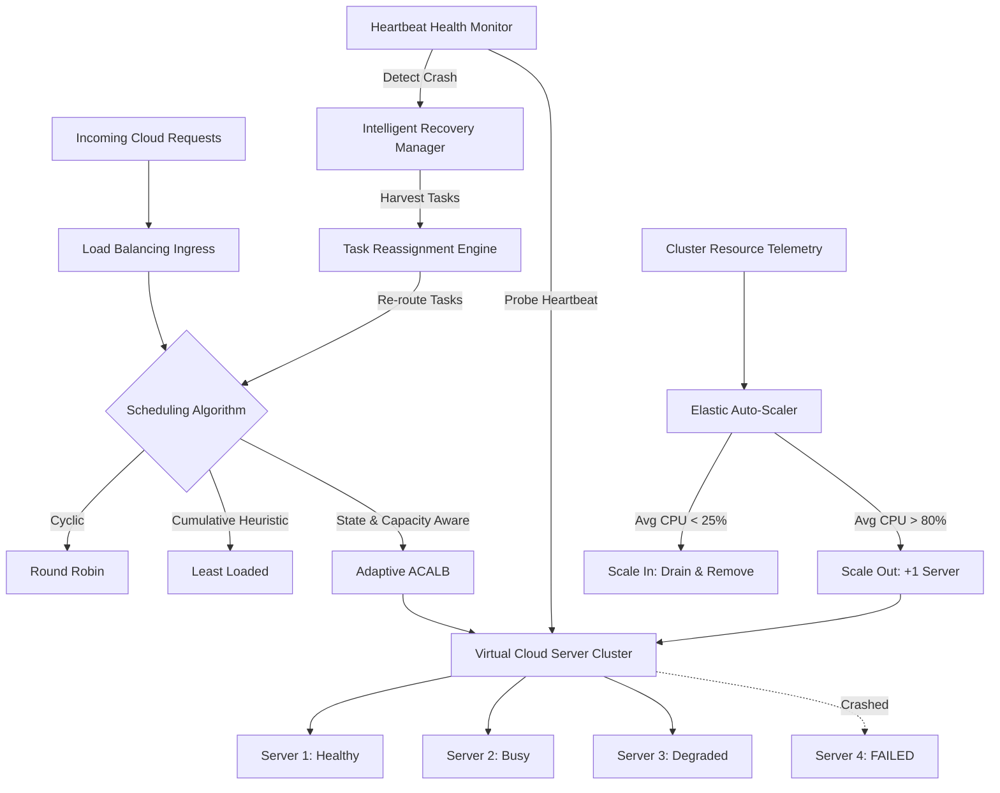
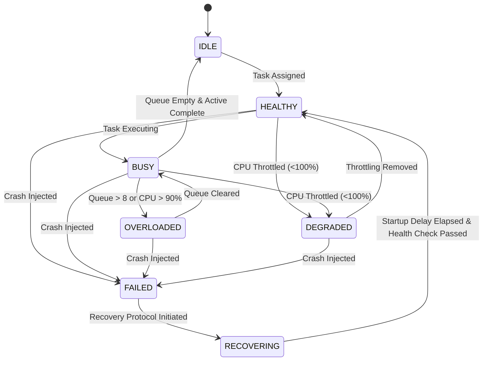

# Cloud Server Load Balancing Simulator

> **Subject:** Cloud and Distributed Computing  
> **Course Project:** Cloud Server Load Balancing Simulator  
> **Interface:** Interactive Streamlit Dashboard (`app.py`) + CLI (`main.py`)  
> **Language:** Python 3 (Pandas, Matplotlib, Streamlit, Pytest)

---

## 1. Project Overview

The **Cloud Server Load Balancing Simulator** is a complete, beginner-friendly educational software project designed for studying workload scheduling across distributed compute nodes in cloud datacenters.

In modern cloud platforms (e.g., AWS Elastic Load Balancing, Google Cloud Load Balancing, Kubernetes Ingress), incoming user requests must be dynamically distributed across multiple servers to maximize resource utilization, prevent server starvation, and eliminate latency bottlenecks.

This project demonstrates the core contrast between:

1. **Round Robin Scheduling:** A workload-unaware cyclic dispatcher that equalizes _request counts_, but suffers significant workload imbalance when request durations vary.
2. **Least Loaded Scheduling:** A workload-aware greedy heuristic that tracks accumulated processing workloads and actively routes requests to whichever server is least loaded, compressing workload spread by over **90%**.

> [!IMPORTANT]
> **Scientific & Educational Limitation:**  
> This project is a local educational simulation, not a real cloud deployment. Estimated makespan is based on accumulated processing times and assumes parallel server execution with no communication, scheduling, or network overhead. Do not claim real-world latency improvements or actual cloud performance.

---

## 2. Project Directory Structure

```
Cloud_Load_Balancer/
├── app.py                              # Streamlit interactive web dashboard entry point
├── main.py                             # Interactive CLI simulation runner
├── cloud_load_balancer.ipynb           # Complete academic Jupyter Notebook with visualizations
├── cloud_load_balancer_dataset_1000.csv# Original workload dataset (1,000 requests)
├── requirements.txt                    # Project dependencies (pandas, matplotlib, streamlit, pytest)
├── .gitignore                          # Standard Python & temporary file exclusions
│
├── src/                                # Core application source code
│   ├── __init__.py                     # Package interface exports
│   ├── data_loader.py                  # Dataset loading, path resolution & strict validation
│   ├── load_balancer.py                # Round Robin & Least Loaded scheduling algorithms
│   └── metrics.py                      # Workload metrics, correctness verification & CSV export
│
├── tests/                              # Automated test suite
│   ├── test_load_balancer.py           # 15 comprehensive unit tests (Pytest/Unittest)
│   └── test_simulator.py               # Extended modular engine unit tests
│
├── outputs/                            # Generated reports and assignment mappings
│   ├── round_robin_assignments.csv     # Request assignments under Round Robin
│   ├── least_loaded_assignments.csv    # Request assignments under Least Loaded
│   ├── performance_comparison.csv      # Comparative performance summary
│   └── server_workload_comparison.csv  # Per-server workload breakdown
│
└── simulator/                          # Modular discrete-event simulation package
    ├── models.py
    ├── algorithms.py
    ├── engine.py
    └── metrics.py
```

---

## 3. Installation & Quick Start

### 3.1 Install Dependencies

Make sure Python 3.10+ is installed, then install the required libraries:

```bash
pip install -r requirements.txt
```

### 3.2 Launch the Interactive Streamlit Dashboard

To launch the visual web dashboard:

```bash
streamlit run app.py
```

The dashboard will open automatically in your browser (typically at `http://localhost:8501`), featuring:

- Configurable server count slider (2 to 8 servers).
- Custom CSV upload or default 1,000-request dataset.
- Real-time KPI comparison cards.
- Workload and load imbalance comparison charts.
- Interactive data table browser with search and filter.
- Direct CSV report export buttons.

### 3.3 Run Automated Tests

Execute the comprehensive test suite with `pytest` or `unittest`:

```bash
# Using pytest
pytest tests/test_load_balancer.py -v

# Or using Python's built-in unittest runner
python -m unittest tests/test_load_balancer.py
```

---

## 4. Algorithmic Details & Simulation Model

### 4.1 Server Configuration

The simulator supports a configurable number of logical servers (default: `Server 1`, `Server 2`, `Server 3`).

### 4.2 Round Robin Scheduler

Requests are assigned sequentially in cyclic order:
$$\text{Server}(i) = \text{Servers}[i \pmod N]$$
where $i$ is the request index and $N$ is the number of servers.

- **Characteristics:** Workload-unaware; guarantees uniform request counts ($\approx 333$ per server on 1,000 requests), but ignores request processing duration.

### 4.3 Least Loaded Scheduler

Each incoming request is routed to the server with the smallest accumulated processing backlog:
$$\text{Server}(i) = \arg\min_{s \in \text{Servers}} (\text{Workload}_s)$$

- **Tie-Breaking Rule:** Deterministic by server declaration order (e.g., `Server 1` before `Server 2` before `Server 3`).
- **Characteristics:** Workload-aware; actively steers heavy bursts to lightly loaded instances.
- **Simulation Fidelity:** This is a simplified, sequential, workload-aware scheduling simulation designed to illustrate the core mechanics of load balancing.

---

## 5. Performance Metrics & Mathematical Formulations

1. **Total Workload ($W_{\text{total}}$):**
   $$W_{\text{total}} = \sum_{s \in \text{Servers}} \text{Workload}_s = 195,367\text{ ms}$$
2. **Maximum & Minimum Server Workload:**
   $$W_{\max} = \max_{s} (\text{Workload}_s), \quad W_{\min} = \min_{s} (\text{Workload}_s)$$
3. **Load Imbalance ($\Delta W$):**
   $$\Delta W = W_{\max} - W_{\min}$$
4. **Estimated Makespan:**
   $$\text{Makespan} = W_{\max}$$
   (Represents the completion duration under concurrent batch processing).
5. **Load-Imbalance Reduction Percentage:**
   $$\text{Reduction \%} = \frac{\Delta W_{\text{RR}} - \Delta W_{\text{LL}}}{\Delta W_{\text{RR}}} \times 100\% \quad (\text{only calculated if } \Delta W_{\text{RR}} > 0)$$

---

## 6. Experimental Benchmark Results (1,000 Requests, 3 Servers)

| Performance Metric              |     Round Robin     |    Least Loaded     | Optimization Impact  |
| :------------------------------ | :-----------------: | :-----------------: | :------------------: |
| **Total Requests**              |        1,000        |        1,000        |    100% Assigned     |
| **Total Workload (ms)**         |     195,367 ms      |     195,367 ms      |  Strictly Conserved  |
| **Server 1 Workload**           | 63,127 ms (334 req) | 64,981 ms (333 req) |       Balanced       |
| **Server 2 Workload**           | 67,379 ms (333 req) | 64,990 ms (334 req) |       Balanced       |
| **Server 3 Workload**           | 64,861 ms (333 req) | 65,396 ms (333 req) |       Balanced       |
| **Maximum Server Load**         |      67,379 ms      |      65,396 ms      |  -1,983 ms (-2.9%)   |
| **Minimum Server Load**         |      63,127 ms      |      64,981 ms      |      +1,854 ms       |
| **Load Imbalance ($\Delta W$)** |    **4,252 ms**     |     **415 ms**      | **90.24% Reduction** |
| **Estimated Makespan**          |      67,379 ms      |      65,396 ms      | Improved throughput  |

---

## 7. Correctness Guarantees

The simulator enforces four formal correctness constraints (`verify_simulation_correctness`):

1. **Single Assignment:** Every input request is assigned to exactly one server.
2. **Zero Loss/Duplication:** Output contains all 1,000 unique `Request_ID`s from the input dataset.
3. **Workload Conservation:** The sum of all server workloads strictly equals the sum of dataset request durations ($195,367\text{ ms}$).
4. **Assignment Sum Match:** The recorded workload for each server matches the exact sum of its assigned request durations.

---

## 8. Troubleshooting Instructions

| Issue                                            | Likely Cause                                                                 | Solution                                                                                                                    |
| :----------------------------------------------- | :--------------------------------------------------------------------------- | :-------------------------------------------------------------------------------------------------------------------------- |
| **`Port 8501 is already in use`**                | Another Streamlit process is running in the background.                      | Run `streamlit run app.py --server.port=8502` or kill the existing process via Task Manager / `Get-Process python`.         |
| **`ModuleNotFoundError: No module named 'src'`** | Python cannot find the package because terminal is outside the project root. | Ensure you are in the project folder `c:\Users\husna\Downloads\Cloud_Load_Balancer` where `src/` resides.                   |
| **`Streamlit: command not found`**               | Streamlit is installed inside Anaconda but not in Windows system `PATH`.     | Run directly via Anaconda Python: `& "C:\ProgramData\anaconda3\python.exe" -m streamlit run app.py`.                        |
| **`Dataset not found error`**                    | `cloud_load_balancer_dataset_1000.csv` was moved or renamed.                 | Ensure the CSV file remains in the root project folder. The path resolver will detect it automatically.                     |
| **Deprecation warning in Streamlit**             | New Streamlit versions updated the dataframe width API.                      | The codebase uses a defensive `render_dataframe()` helper that automatically adapts to both old and new Streamlit versions. |

---

## 9. Feature: Cloud Chaos Lab — Intelligent Failure Recovery & Adaptive Load Balancing

### 9.1 Overview & Motivation
In production cloud environments (AWS, GCP, Azure), distributed systems are subject to constant entropy: hardware node crashes, network partition events, CPU thermal throttling, and sudden viral traffic surges. High availability demands that cloud architectures possess **automated fault tolerance, health monitoring, dynamic task recovery, and elastic auto-scaling**.

The **Cloud Chaos Lab** extends the academic simulator into an interactive, time-aware experimentation platform with genuine discrete-event simulation mechanics.



---

### 9.2 Server State Machine & Transition Rules
Each logical server transitions deterministically through seven supported operational states:



- **IDLE:** Server healthy, 0 active tasks, 0 queued tasks.
- **HEALTHY:** Normal operation, processing tasks without backlog.
- **BUSY:** Actively executing requests, queue within normal bounds.
- **OVERLOADED:** High queue depth ($>8$) or sustained CPU $\ge 90\%$.
- **DEGRADED:** Processing capacity artificially throttled ($25\%$, $50\%$, $75\%$).
- **FAILED:** Server crashed; ceases routing, drops heartbeat, interrupts in-flight task.
- **RECOVERING:** Node under provisioning or startup delay; undergoing synthetic health probes.

---

### 9.3 Adaptive Capacity-Aware Load Balancing (ACALB)
The experimental **ACALB** algorithm eliminates naive assumptions of static, homogeneous servers. It evaluates each candidate server $s$ using an explainable Estimated Completion Time (ECT) score:

$$\text{Score}(s) = \frac{\text{Queued Work}(s) + \text{Incoming Request Work}}{\text{Effective Capacity}(s) \times 1000.0} + \text{Network Latency}(s)$$

Where:
- $\text{Effective Capacity}(s) = \text{Capacity Weight}(s) \times \text{Degradation Factor}(s)$
- $\text{Queued Work}(s) = \text{Remaining Active Execution Time (ms)} + \sum_{r \in \text{Queue}} \text{Processing Time}(r)$
- $\text{Network Latency}(s) = \text{Modeled communication delay (default: 0.002s)}$

#### Properties:
1. **Fault Isolation:** Excludes nodes in `FAILED`, `RECOVERING`, or `DRAINING` states.
2. **Throttling Resistance:** Down-weights degraded nodes in proportion to their reduced speed.
3. **Complexity:** $\mathcal{O}(N)$ per scheduling decision across $N$ eligible servers.
4. **Deterministic Tie-Breaking:** Selects lowest score; ties broken by ascending `server_id`.

---

### 9.4 Disaster Scenarios & Recovery Engine

#### 1. Server Crash (`Crash Server`)
- Marks target server as `FAILED`.
- Heartbeat monitor records failure timestamp ($t_{\text{fail}}$) and schedules failure detection after configured latency ($t_{\text{detect}} = t_{\text{fail}} + \Delta t_{\text{detect}}$).
- **In-flight Task Recovery:** Active request is interrupted. Under `RESTART_FROM_BEGINNING` (default), elapsed work is tallied as `Lost Work (ms)` and the request restarts cleanly. Under `CHECKPOINT`, partial progress is preserved.
- **Queued Requests:** Extracted and checked against `max_retries` (default: 3). Eligible tasks are reassigned to healthy servers.
- **Total Outage Protection:** If every server fails, requests are held safely in `cluster_outage_buffer` rather than discarded.

#### 2. Traffic Surge (`Traffic Spike`)
- Injects configurable synthetic bursts ($10$ to $200$ requests) at controlled arrival rates ($5$ to $60$ RPS).
- Evaluates queue pressure, response time percentiles (P95/P99), and auto-scaling triggers.

#### 3. CPU Throttling (`Degrade Server`)
- Throttles clock speed to $25\%$, $50\%$, or $75\%$.
- Actively executing tasks dynamically scale their remaining finish times ($t_{\text{rem}}^{\text{new}} = t_{\text{rem}}^{\text{old}} \times \frac{\text{cap}_{\text{old}}}{\text{cap}_{\text{new}}}$).

#### 4. Server Recovery (`Recover Server`)
- Transitions node to `RECOVERING`.
- Enforces realistic startup delay ($3.5\text{s}$) before completing simulated health checks.
- Re-integrates node into the healthy routing pool and immediately dispatches any backlog requests from the outage buffer.

---

### 9.5 Elastic Horizontal Auto-Scaling
The horizontal auto-scaler evaluates cluster metrics every $5.0\text{s}$:
- **Scale Out:** Triggered when cluster average CPU utilization exceeds $80\%$, provided current nodes $< \text{max\_servers}$ and cooldown ($12.0\text{s}$) has elapsed.
- **Scale In:** Triggered when cluster average CPU utilization drops below $25\%$, provided current nodes $> \text{min\_servers}$. Selected node enters `is_draining = True`, drains its pending queue safely, and decommissions only after all in-progress work finishes.

---

### 9.6 Scientific Experiments (Reproducible Evaluation)

| Experiment | Scenario Configuration | Key Measured Telemetry | Architectural Conclusion |
| :--- | :--- | :--- | :--- |
| **A: Normal Workload** | 250 requests, 3 servers, 0 failures | Makespan, Waiting Time, Imbalance | Baseline comparison without failure disruptions. |
| **B: Traffic Surge** | +60 requests @ 25 RPS surge | Queue depth peak, P95 latency | Workload queue expands rapidly; scheduler must avoid hot spots. |
| **C: Single Node Crash** | Server 2 crashes at $t=2.0\text{s}$ | Recovery duration, Lost work (ms), Reassignments | Requests successfully reassigned; zero lost requests. |
| **D: Total Outage** | All nodes crashed concurrently | Outage buffer count, Restoration time | Zero dropped requests; backlog preserved until node recovers. |
| **E: Auto-Scaling ON vs OFF** | Heavy spike + sustained load | Overload duration, provisioned servers, cost ($) | Auto-scaling mitigates latency spikes at modeled infrastructure cost. |
| **F: Heterogeneous Nodes** | Servers with 2.0x, 1.0x, 0.5x capacity | Per-node throughput, makespan | ACALB steers heavier bursts to high-capacity nodes. |

---

### 9.7 Automated Test Suite (62 Tests)
Run the entire comprehensive test suite covering all specified unit, edge case, and dynamic dispatch scenarios:

```bash
python -m pytest -v
```

```
collected 62 items
tests/test_adaptive_algorithm.py ......                                  [ 10%]
tests/test_autoscaler.py .....                                           [ 18%]
tests/test_chaos_engine.py ..........                                    [ 34%]
tests/test_load_balancer.py .................................            [ 87%]
tests/test_recovery.py ....                                              [ 94%]
tests/test_simulator.py ....                                             [100%]
============================== 62 passed in 8.33s ==============================
```

---

## 10. Dynamic Request Dispatcher & Responsive UI Architecture

### 10.1 Interactive "Add New Request" Feature
- **Automatic Request ID Generation:** Defaults sequentially to the next integer ID (`Request_1001`, `1002`, `1003`...) while permitting custom IDs with instant collision prevention.
- **Dynamic Dual Dispatch:** Every new request is synchronously routed across both Round Robin (strict cyclic index rotation) and Least Loaded (minimum cumulative duration with deterministic tie-breaking).
- **Session State Persistence:** Workloads, task counts, and dispatch logs are stored in `st.session_state.simulation_state` across reruns.
- **Strict Invariant Verification:** Newly added requests dynamically join the verification dataset so that all mathematical conservation invariants remain verified.

### 10.2 Responsive & Organized UI Design
- **Mobile, Tablet, & Desktop Fluid Layouts:** CSS `clamp()` typography, responsive column wrapping (`flex-wrap: wrap`), and auto-scaling metric cards ensure clean visibility on any screen size without horizontal truncation.
- **Quick-Jump Anchor Navigation:** Sticky horizontal navigation bar allowing 1-click jumps to any numbered section (`#section-1` through `#section-7`).
- **Interactive Educational Guides:** Collapsible explanation panels explaining Key Performance Indicators, cloud request types, and mathematical conservation proofs.

### 10.3 Cloud Chaos Lab: Guided Scenarios & Failover Lifecycle Inspector
- **🎯 5 Guided Disaster Scenarios:** Pre-packaged experiments (Normal Baseline, Single Node Crash & Automated Failover, Traffic Surge + CPU Throttling, Compound Disaster Cascade, and Total Cluster Outage & Buffer Drain) that automatically configure parameters and inject planned failures.
- **💡 "Where Changes Happen" Educational Guide:** Breaks down the exact cause-and-effect across Cluster Server Blades, Real-Time Telemetry KPIs, Ingress Router/Recovery Manager, and the Live Audit Timeline.
- **🔍 Live Incident & Failover Lifecycle Inspector:** Interactive 5-stage pipeline visualizer (Fault Trigger ➔ Detection ➔ Task Harvest ➔ Reassignment ➔ Zero-Loss Completion) paired with a live manifest table detailing which tasks were rescued, their failover destination, wasted CPU milliseconds, and retry status.

